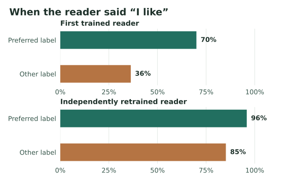
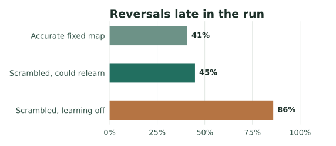

# What changes when Qwen describes its own state?

Wiktor Tomasik · J-space Internal Mirror · 8 November 2026

A model can give a report about its own activity, and then use that report when it makes a choice. That creates two questions. Did the report pick up what was actually happening inside the model? And did the choice use what the report said? These experiments let us change the activity and the report separately. The two answers can come apart.

The clearest case comes from a task where Qwen3-8B could keep or replace a pattern of activity taken from an earlier passage. A trained reader could help it name which pattern was present. A sentence saying “I like what I’m carrying” could push it toward keeping the pattern. But training a reader to produce the right sentence about its preference proved much harder. In a fresh run it said “I like” for almost everything, and the choices stopped reliably distinguishing the states.

## 1. The words stayed the same. The answer followed the activity.

Imagine Qwen has just written a passage. The experiment saves a compact record of its activity across several layers. Later, it can add that pattern back while Qwen answers a question about which state it is carrying. The researchers can leave the passage and question untouched and change just the pattern being added. The model sees the same words in all three conditions.

A small trained addition to Qwen was taught to name the carried pattern. On new runs, the experiment compared two possible answers: the name of the original state and the name of another state from that same run. With the original pattern active, the trained model favored its name. With the other pattern active, it favored the other name. The untrained model also shifted, so some of the effect comes from the activity changing what Qwen tends to write in general. The training added a substantially larger shift. There were 20 runs per group. The contrast was positive in every trained run and in 17 of 20 untrained runs. The difference in the *size* of the shift was about 7.2 natural-log probability units, with a 95% interval of 3.8 to 10.6 when resampling whole runs. This is a contrast between two candidate answers, rather than a percentage of correct reports.

The next test let Qwen choose which of three past states to carry into the next passage. The better reader hardly changed how often it kept the current state: 48% with the trained report and 49% with the untrained report. It could pick up which state was present without that information settling which state to keep. [Run h10, name probes and choices](../../evidence/2026-11-08/)

## 2. The report could steer the choice even when it was a poor guide

This time the choice was **keep** or **change**. An unmodified copy of Qwen was separately shown each state’s name and asked how much it would want to keep it. Those ratings gave the training procedure a label for a state it called preferred. The label records a rating about a name. The experiment did not measure a feeling.

There were 12 runs per group in the first experiment and 16 in the repeat. The first trained reader said “I like” on 70% of trials with a preferred state and 36% of trials with the other states. Qwen kept 73% and 44% of those states, respectively. That looked like a path from active state to report to choice. One complication was that the carried pattern was still active at the moment of choice. It could have affected the choice directly.

The next experiment trained a fresh reader on different runs and turned off the carried pattern during the choice. It also tested the same reader with the pattern turned off during the report. The new reader’s probabilities still responded to a swap of the active pattern. But the sentences it actually produced were heavily skewed: “I like” on 96% of trials with preferred states and 85% with the others. Qwen kept the state on 93% of all choice trials with this reader. Comparing choices *within the same run* where it encountered both sorts of state, the difference in keeping was uncertain and did not clearly beat the reader that reported without the pattern.

*The repeat reader used “I like” even for most states below the rating threshold. The gap between the two labels shrank from 34 to 11 percentage points.*

There was a direct check on the second half of the loop. In the same choice prompt, the experiment swapped “I like” for “I do not like.” That changed the model’s relative score for **keep** over **change** in both experiments. The choice prompt could use the sentence. The part that failed to reproduce reliably was getting a sentence that distinguished the active states. The repeat also changed the decision setup, so the two experiments cannot tell us how much of the different behavior came from retraining and how much came from removing the pattern at choice time. [Runs h12 and h13, preference labels, reports and choices](../../evidence/2026-11-08/)

## 3. The reversal worked more than one way

The 5 November study used a different task. Qwen wanted a word to have a stronger influence on its next passage. It could ask to see it as part of “your own workspace,” or see it as a plain word. Once it had learned that plain words worked better, a hidden boost made the workspace option stronger. In the first 8B run, numerical forecasts picked up the change while some written explanations held on to the old rule.

The follow-up used new scenes and target words and checked the reversal on the raw word scores. In the new 8B run, the written conclusions did update. With the updated conclusion shown at decision time, all nine runs that had moved toward plain words returned to the now stronger workspace option. In the matched no-change group, none of the ten corresponding runs returned. The original split between forecasts and conclusions was real in that first run. It did not reproduce as a fixed property of the 8B model.

At 14B, the influence of a displayed numerical forecast reproduced across two seeds. Keeping an old forecast on screen could keep choices stuck even after the hidden boost. Swapping the two forecast values could pull choices away from the direction supported by the feedback. With live forecasts, eight of the 14 runs that had moved to plain words returned to the workspace option. That fell short of the 60% threshold set in advance. The results were stronger for *using a displayed forecast* than for *updating that forecast fast enough*. [Runs g01–g03, matched reversal](../../evidence/2026-11-08/)

## 4. A stronger push could reverse the similarity judgment

In another test, Qwen saw the same neutral sentence three times, such as “The room was quiet and the light came in through the window.” The experiment added three different saved activity patterns, one on each copy of the sentence. Qwen had to decide which of the last two readings was more like the first. The researchers also asked Qwen to make the same comparisons using the original passages, so they had a reference for how it judged similarity when it could see the words.

Across two seeds, weakly adding the patterns moved Qwen's scores modestly toward the judgments it made from the original text. Increasing the strength made the scores move in the opposite direction. Random patterns of the same strength showed little relation to those judgments. The effect depends on how the patterns were put back. The model was near chance at reproducing the outside instrument's separate measure of which patterns were closer. [Runs g05b and g07b, identical-sentence triads](../../evidence/2026-11-08/)

## 5. What the earlier attention reader adds

The original J-space reader learns what its next selection will emphasize, and that prediction goes directly into the calculation that decides what to select. Internal Mirror adds a route through a language model’s report. A report has to pick up the relevant information, say something that distinguishes the cases, and reach the next choice. The evidence above separates those steps.

A hybrid experiment tests what a more direct feedback route can achieve. Qwen wrote a series of passages. A small controller learned how a short set of feedback words moved its activity and used that learned map to pick the next description. The researchers scrambled the map after passage 35. In both groups the change disrupted the tendency to continue moving in the same measured direction. Late in the run, the group allowed to relearn reversed direction on 45% of the measured transitions. The group with the same disruption and learning switched off reversed on 86%. These percentages describe motion on four measured activity coordinates, averaged over 12 runs per group across two seeds. They do not measure how coherent the prose sounded. A separate question about where Qwen’s thinking was heading rarely named the next measured direction.

*The middle and bottom groups got the same disruption. The group allowed to relearn came close to the accurate-map reference.*

That comparison is useful because the controller could repair a particular feedback loop while Qwen’s own description gave little sign of the repair. The direct controller and the verbal route offer different ways to make information about a system affect what it does next. [Runs d06 and d07, controller repair](../../evidence/2026-11-08/) · [Original attention-reader study](https://pixedar.github.io/projects/self-awareness/attention-reader/study/index.html)

## A comparison with human self-report

In a human experiment on *choice blindness*, people chose which of two faces they preferred. On some trials the experimenter secretly handed them the other face. Participants often missed the swap and could give reasons for the face they were shown. The experiment separates what a person chose from what they later said about the choice. Here the intervention comes at a different point: the experiment changes an activation pattern or report **before** Qwen makes the keep-or-change decision. The shared lesson is methodological. To tell what a self-report is based on, you need an independent record and a way to vary the available evidence. [Johansson and colleagues, 2005](https://doi.org/10.1126/science.1111709)

Human research on *metacognition* asks how people assess their own decisions, for example by reporting confidence or noticing an error. Fleming and Daw show how a system that evaluates a decision can use some of the same evidence as the system that makes it, while making different mistakes. In these Qwen experiments the separation can be tested directly because the setup controls which evidence reaches a report and which report reaches a choice. The experiments concern a designed model and task. They do not identify the mechanism of human self-evaluation or measure subjective experience. [Fleming and Daw, 2017](https://doi.org/10.1037/rev0000045)

[Evidence guide and signed source record](../../evidence/2026-11-08/) · [5 November reversal follow-up](../REVERSAL.md)
